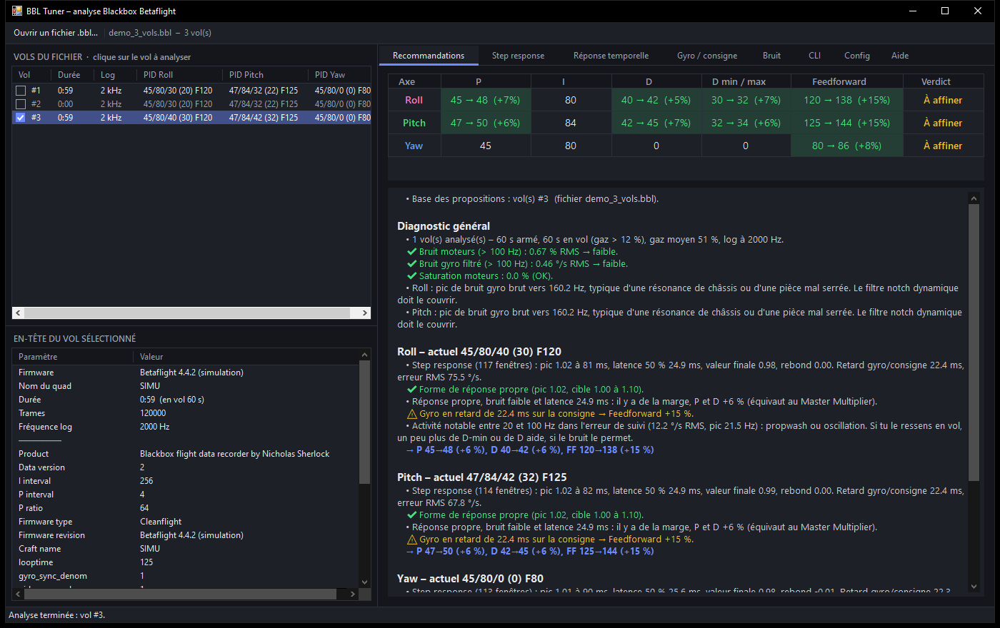
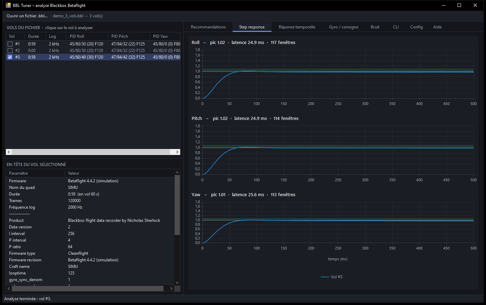
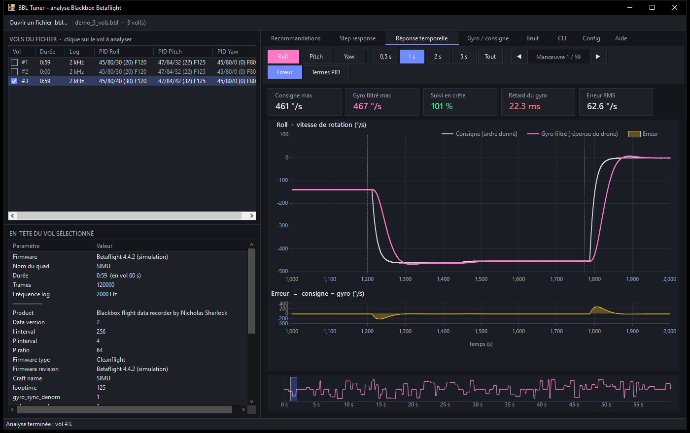
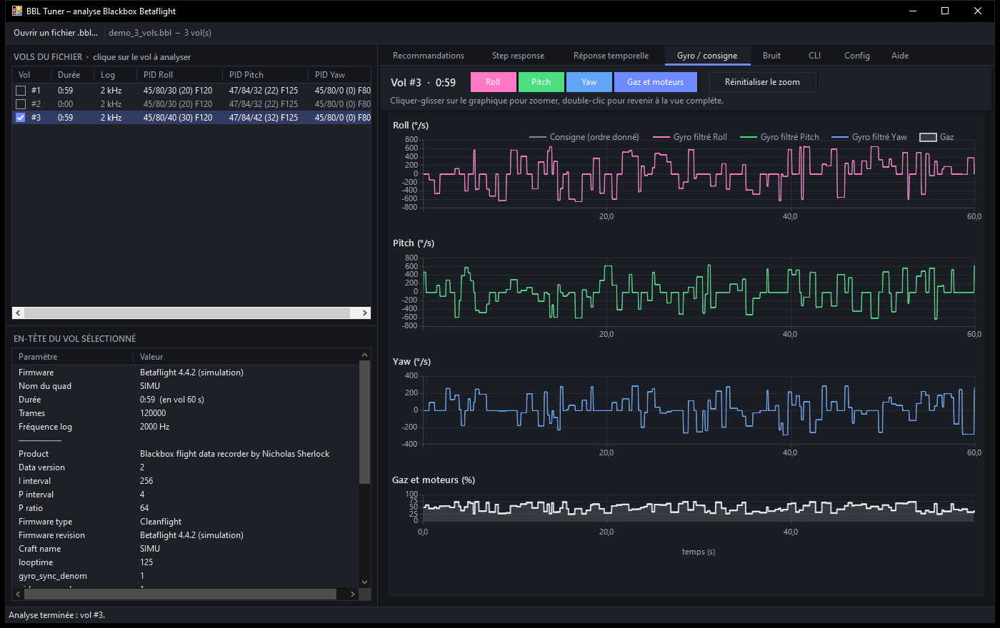
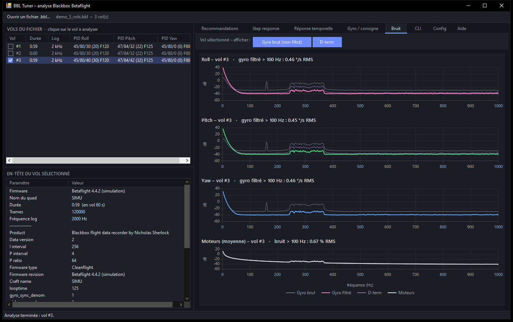

# BBL Tuner

**Betaflight Blackbox log analysis and PID tuning suggestions, in a standalone Windows application.**

BBL Tuner opens a `.bbl` / `.bfl` file, finds every flight it contains, decodes the gyro and setpoint data, then suggests corrected PIDs. It can also apply these values directly to your Betaflight config (`diff all`).

The interface is in French; button and tab names are given below as they appear in the app, with their meaning.



---

## Features

- **Native Blackbox decoder.** It reads every flight in the same file and supports all Betaflight encodings and predictors as well as `blackbox_high_resolution` mode. Corrupted frames are skipped and reading resynchronises.
- **Step response** by Wiener deconvolution, the same method as PID-Analyzer: overshoot (peak), 50 % latency and number of windows used, per axis.
- **Time response.** The setpoint is overlaid on the filtered gyro, with the error curve. Navigation by manoeuvre, windows from 0.5 s to "Tout" (all), and optional display of the P/I/D/F terms.
- **Gyro / setpoint.** Full flight traces, with throttle and motors, and mouse zoom.
- **Noise.** Spectra (Welch) of the raw gyro, filtered gyro and motors, with resonance peak detection.
- **PID recommendations** for P, I, D, D min/max and Feedforward, per axis. Each suggestion is explained, and changes are limited to ±25 % per iteration.
- **Betaflight CLI** ready to paste (with `simplified_pids_mode = OFF` so the sliders do not overwrite the values).
- **Config correction.** Opens a `diff all`, automatically picks the profile that matches the flight, and shows the changes line by line. It then saves a `_corrige.txt` copy without ever modifying the original.
- **Dark theme** interface, and no installation needed.

| Step response | Time response |
|---|---|
|  |  |

| Gyro / setpoint | Noise |
|---|---|
|  |  |

---

## Installation

There is nothing to install. The application runs on Windows 10/11, with .NET Framework 4.x, which is already part of the system.

1. Download `BBLTuner.exe` from the [Releases](../../releases) page, or build it (see below).
2. Run it.

## Usage

1. **Get the log.** In Betaflight Configurator, *Blackbox* tab, click *Activate Mass Storage Device Mode*, or use the SD card. Copy the `.BBL` file.
2. **Open it in BBL Tuner.** Use the *Ouvrir un fichier .bbl…* (open a .bbl file) button or drag and drop the file onto the window. Each arming becomes a row in the flight list.
3. **Pick a flight.** It is analysed immediately. Flights that are too short or unusable are greyed out.
4. **Read the *Recommandations* tab.** Copy the block from the *CLI* tab into the Betaflight CLI, then type `save`.
5. **Or fix your config directly.** In the *Config* tab, open your `diff all` file, check the profile, then click *Enregistrer la config corrigée…* (save the corrected config).

You can also pass the files on the command line:

```bash
BBLTuner.exe my_log.bbl my_config.txt
```

### Tips for a usable log

- Set `blackbox_sample_rate` to **1 kHz minimum** (2 kHz is ideal), with the `GYRO_SCALED` or `NONE` debug mode.
- Fly for at least **20 to 30 seconds** with **sharp moves**: flips, rolls, quick direction changes. A hover flight does not give enough data for the step response.
- Tune the **filters** before the PIDs: a noisy gyro skews the D analysis.
- Work **in small iterations**: apply, fly, log again, analyse again.

> ⚠️ The suggestions are a starting point computed from the data, not a guarantee. Check the motor temperature after each change, especially when D goes up.

---

## Build

No SDK is needed: the script uses the C# compiler that ships with Windows.

```bash
powershell -ExecutionPolicy Bypass -File build.ps1
```

The script produces:

- `bin/BBLTuner.exe`, the application;
- `bin/BblTests.exe`, the command-line test tool.

### Tests

```bash
bin/BblTests.exe check
```

`check` encodes simulated flights with an encoder that reproduces the Betaflight firmware's one. It decodes them again and checks that every value read back is identical to the one written. Finally it checks that the analysis finds the expected theoretical overshoot.

Other commands:

| Command | Role |
|---|---|
| `analyze <log.bbl>` | Text analysis report of a real log |
| `config <config.txt>` | Simulated correction of a config, without writing |
| `seg <log.bbl> <flight no.>` | Signal amplitudes in 1 s segments |
| `gen <file.bbl>` | Generates the demo file |

---

## Project structure

| File | Role |
|---|---|
| `src/Bbl.cs` | Blackbox format decoder (multiple logs, predictors, encodings, resynchronisation) |
| `src/Dsp.cs` | FFT, Welch, Wiener deconvolution, cross-correlation, decimation |
| `src/Analysis.cs` | Per-axis metrics and PID recommendation engine |
| `src/Config.cs` | Reading and correcting Betaflight configs (`diff all`) |
| `src/MainForm.cs` | Main window, flight list, analysis tabs |
| `src/RespTab.cs` | *Réponse temporelle* (time response) tab |
| `src/TraceTab.cs` | *Gyro / consigne* (gyro / setpoint) tab |
| `src/ConfigTab.cs` | *Config* tab |
| `src/Theme.cs`, `src/UiKit.cs`, `src/DarkUi.cs` | Dark theme and UI components |
| `src/Program.cs` | Entry point and error log |
| `tests/Tests.cs` | Synthetic encoder and test bench |
| `demo/demo_3_vols.bbl` | Demo log: under-damped flight, too-short flight, over-damped flight |

## References

- [Betaflight – PID Tuning Guide](https://betaflight.com/docs/wiki/guides/current/PID-Tuning-Guide)
- [Betaflight Blackbox Log Viewer](https://github.com/betaflight/blackbox-log-viewer), as the format reference
- [PID-Analyzer](https://github.com/Plasmatree/PID-Analyzer), for the step response method
